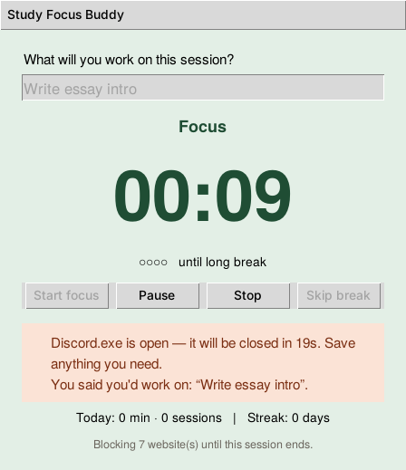
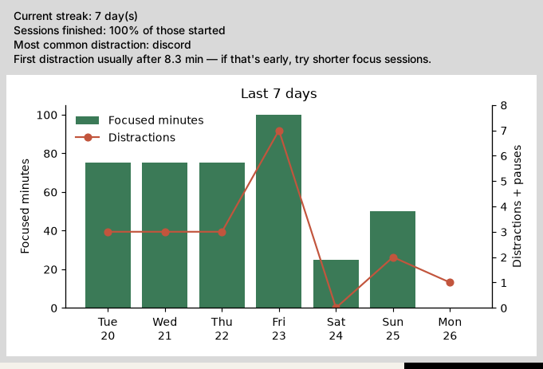

# Study Focus Buddy

A Python desktop app that protects a study session from distraction — not just a Pomodoro
timer. You commit to one task, the app blocks distracting websites, watches for distracting
apps (warning you or closing them), and afterwards shows you *what* pulls you away and *when*.

Creative Coding · Assignment 2 prototype · Xiaohan Chen



*Focus session in demo mode, with a simulated Discord process detected by the app guard.*

## What it does

| Feature | What it solves |
|---|---|
| **Task commitment** | You can't start until you name one concrete task. Vague goals are easy to drift from. |
| **Focus / break timer** | Deadline-based 25/5 cycle with a long break every 4 sessions; all lengths customisable. |
| **Website blocking** | Blocks sites (YouTube, Bilibili, Reddit…) in every browser for the length of the session, then unblocks automatically. |
| **App guard** (psutil) | Detects distracting apps during focus. *Warn* mode shows an in-app banner reminding you of your task; *Close* mode also closes the app after a grace period. |
| **Quiet notifications** (plyer) | Only when a session or break **ends** — never during focus. |
| **Reflection + history** | One-click "did you finish?" after each session; streak, completion rate, top distraction, and a 7-day chart (matplotlib). |

Why each feature exists, the notification rule, and what happens on detection are explained
in [`docs/DESIGN.md`](docs/DESIGN.md).

## File structure

```
study-focus-buddy/
├── main.py                  # start the app (python main.py)
├── requirements.txt         # pip dependencies
├── focusbuddy/              # the application package
│   ├── config.py            # settings dataclass, load/save JSON, input cleaning
│   ├── timer.py             # FocusTimer state machine (no GUI code, unit-tested)
│   ├── guard.py             # DistractionGuard: detect / warn / close apps with psutil
│   ├── site_blocker.py      # HostsBlocker: website blocking via the hosts file
│   ├── notifier.py          # Notifier: plyer notifications, phase boundaries only
│   ├── history.py           # SessionLog: session records + statistics
│   ├── charts.py            # 7-day matplotlib chart
│   └── gui.py               # tkinter window, settings, reflection and history dialogs
├── tests/
│   └── test_core.py         # 21 unit tests (pytest)
├── docs/
│   ├── DESIGN.md            # feature rationale, notification policy, reference projects
│   └── screenshots/
└── versions/
    └── v0_basic_pomodoro.py # annotated original-scope version, kept for comparison
```

## Installation

Requires **Python 3.9+** (tested on 3.12). tkinter ships with Python on Windows and macOS;
on Linux install it with `sudo apt install python3-tk`.

```bash
git clone https://github.com/Lazarusli0210/study-focus-buddy.git
cd study-focus-buddy
pip install -r requirements.txt
# or: pip install plyer psutil matplotlib
```

All three packages are optional at runtime: without psutil the app guard is disabled,
without plyer it beeps instead of notifying, without matplotlib the history shows text only.

Check what works on your computer:

```bash
python main.py --check
```

## Running

```bash
python main.py            # normal use
python main.py --quick    # demo mode: one "minute" lasts one second, for testing/marking
```

1. Type what you'll work on and press **Start focus** (or Enter).
2. Work. If you open a blocked app, a banner appears and reminds you of your task.
3. When the timer ends you get one notification and a one-click reflection question.
4. **Menu → Settings** to change durations, guard mode (`off` / `warn` / `close`), and block lists.
5. **Menu → History** for your streak, top distraction and the 7-day chart.



*History window (filled with demo data for this screenshot).*

Data is stored in `~/.study_focus_buddy/` (`settings.json`, `history.jsonl`).

### Website blocking (needs admin rights)

Website blocking edits the system hosts file, which only an administrator can change. It is
**off by default**; turn it on in Settings, then start the app with admin rights:

- **Windows:** open *Command Prompt* with "Run as administrator", then `python main.py`
- **macOS / Linux:** `sudo python3 main.py`

The app only edits lines between its own marker comments and removes them when the session
ends, when you quit, and on next start-up if it ever crashed. Already-open tabs may keep
working for a minute until the browser's DNS cache expires.

## Running the tests

```bash
pip install pytest
python -m pytest
```

The tests use a fake clock and fake process lists, so they run instantly and never touch
real apps or your real hosts file.

## Credits and borrowed code

All code is original unless a comment says otherwise. Techniques adopted from documentation
or other projects are credited in the comment at the top of the module that uses them:

- `root.after()` update loop — tkinter docs; GeeksforGeeks Pomodoro tutorial (`gui.py`)
- `process_iter()` / `terminate()` patterns — psutil documentation (`guard.py`)
- `notification.notify()` signature — plyer documentation (`notifier.py`)
- Embedding a Figure in Tk — matplotlib "Embed in Tk" example (`charts.py`, `gui.py`)
- Hosts-file blocking idea — SelfControl, StevenBlack/hosts (`site_blocker.py`)

Reference projects used as design guides are listed in [`docs/DESIGN.md`](docs/DESIGN.md#5-reference-projects-guides-not-copied-code).

## License

MIT — see [LICENSE](LICENSE).
